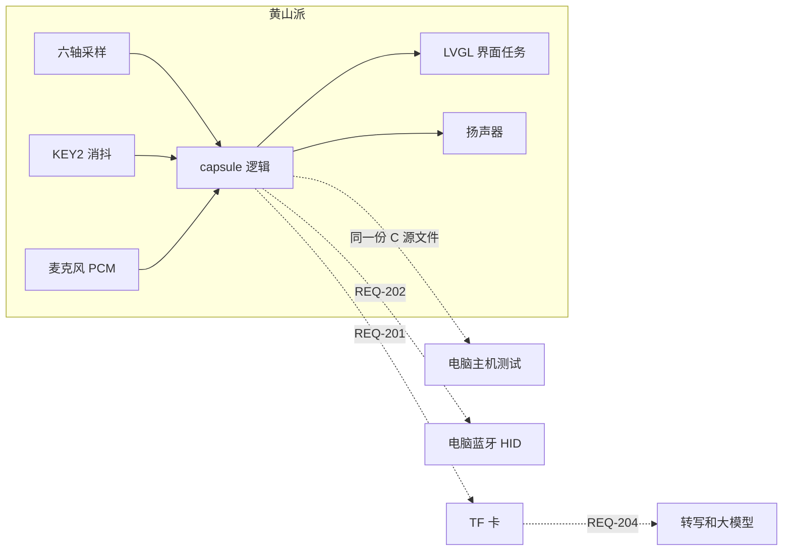
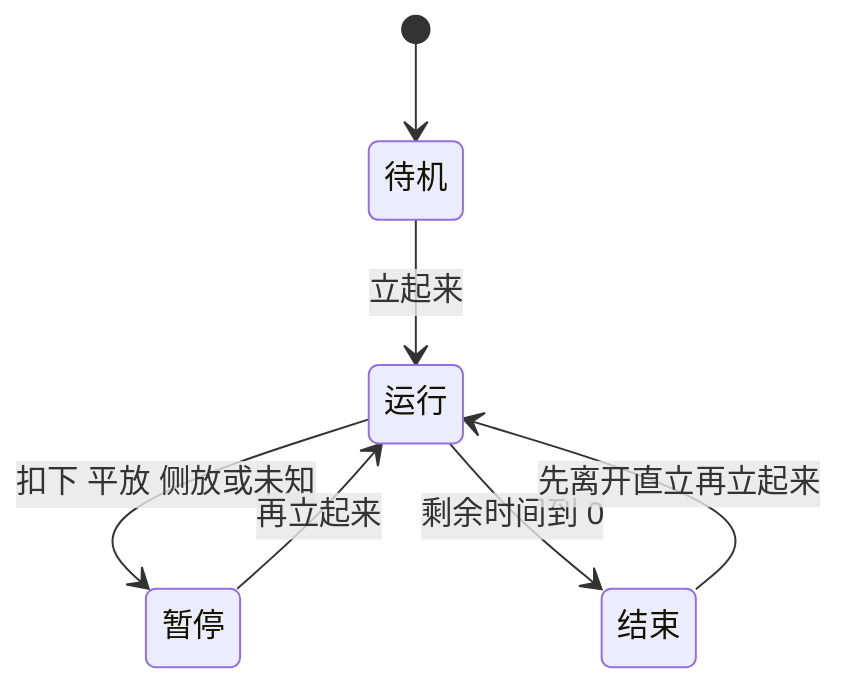
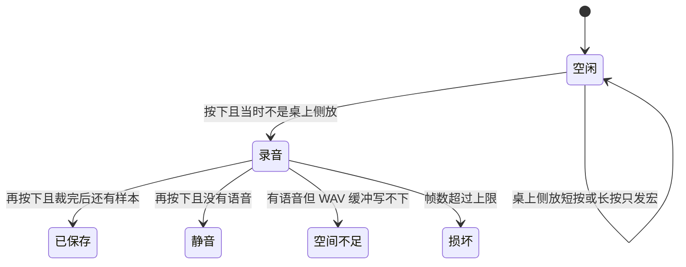

# 方案设计说明

| 项 | 内容 |
|---|---|
| 文档编号 | DOC-02 |
| 项目名称 | 闪念胶囊 |
| 版本 / 状态 | v0.2 / 草稿 |
| 负责人 / 日期 | 待填写 / 2026-11-02 |

## 修订记录

| 版本 | 日期 | 修改人 | 修改内容 | AI参与 |
|---|---|---|---|---|
| v0.2 | 2026-11-02 | 待填写 | 按 REQ 编号写模块、状态机和板上接法 | 是 |

## 1. 设计输入

- 需求来源：`01-需求规格说明.md` v0.2
- 硬件平台：黄山派 SF32LB525UC6，板型 sf32lb52-lchspi-ulp；SDK 版本 v2.5.1
- 约束：无 WiFi。套件不含 TF 卡、电池和马达。逻辑不调用传感器、屏幕和蓝牙，方便在电脑上测试。

## 2. 总体架构

黄山派负责姿态、计时、录音和回放。电脑这一版负责编译主机测试。蓝牙、TF 卡和大模型在图上标成还没接。

`src/SConscript` 会把 `capsule/src` 和 `src/main.c` 编在一起。`main` 在 RGB 灯循环之前调用 `capsule_selftest`。IMU、按键、麦克风和界面还没接到这层逻辑上。

## 3. 模块划分与需求追踪

| 模块 | 职责 | 对外接口 | 实现的需求 | 代码路径 | 测试 |
|---|---|---|---|---|---|
| pose | 标定向量、余弦相似、64 字节导入导出、毫 g 换算 | `capsule_pose_match`、`capsule_accel_millig`、`capsule_pose_map_export` | REQ-001、REQ-102、REQ-103 | `capsule/src/pose.c` | TC-001 |
| 计时 | 25 分钟的待机、运行、暂停、结束和提示 | `capsule_on_time`、`capsule_take_beep` | REQ-002、REQ-003 | `capsule/src/capsule.c` | TC-002、TC-003 |
| 按键策略 | 录音或宏；桌上状态 | `capsule_on_key_down`、`capsule_on_key_up` | REQ-004、REQ-005 | `capsule/src/capsule.c` | TC-004、TC-005 |
| vad | 按帧去掉静音 | `capsule_vad_trim` | REQ-004、REQ-205 的替代 | `capsule/src/vad.c` | TC-004 |
| wav | 16 kHz 单声道读写 | `capsule_wav_write`、`capsule_wav_read` | REQ-004、REQ-104 | `capsule/src/wav.c` | TC-004 |
| 自检 | 启动时跑几条不碰硬件的检查 | `capsule_selftest` | REQ-102 的冒烟 | `capsule/src/selftest.c` | TC-007 |
| 界面 | 只显示，不在回调里画 | 尚未实现 | REQ-006 | 还没有 | TC-006 |
| 采样时序 | 调用方保证周期 | 文档约定 | REQ-101 | `capsule/README.md` | TC-101 |
| TF / HID / 同步 / 待办 / 外壳 | 本期不实现 | 无 | REQ-201、REQ-202、REQ-203、REQ-204、REQ-206 | 无 | TC-201 |

## 4. 接口设计

### 4.1 软件接口

调用顺序和缓冲大小见 `capsule/README.md`。各接口共用同一个毫秒时钟。

| 接口 | 输入 | 输出 | 错误处理 | 说明 |
|---|---|---|---|---|
| `capsule_init` | PCM 与 WAV 缓冲 | 0 或 -1 | 容量不够或地址奇数则失败，不改结构体 | REQ-104 |
| `capsule_capture` | 姿态枚举 | 0 或 -1 | 没有样本或不是静止重力时不覆盖 | REQ-001 |
| `capsule_pose_map_import` | 64 字节 | 0 或 -1 | 失败不改原表 | REQ-103 |
| `capsule_on_accel` | 毫 g 和时间 | 无 | 时间倒退则整拍丢掉 | REQ-002 |
| `capsule_on_pcm` | PCM | 0 或 -1 | 写满后停录并保留已写入的语音 | REQ-004 |
| `capsule_take_beep` | 无 | 是否该响一声 | 取走后清除 | REQ-003 |

### 4.2 数据结构与状态机

姿态要先稳定 400 ms。下面的“立起来”都指稳定之后的直立。

结束提示在进入结束时置位。扣下会清掉还没取走的提示，并把静音设为真。走完和扣下落在同一拍时也一样。平放和侧放只暂停，并取消静音。未知暂停并取消静音，不吞掉已经置位的提示。时间戳倒退时这一拍丢掉，加速度读数也不改。

录音和计时互不取消。

按下开始之后，松开不结束。缓冲区写满则自动停，规则和再按一次相同。

桌面标记：稳定的直立、平放、扣下会打开它。侧放不改变它。稳定的未知持续满 3 秒后关掉。关掉之后，侧放也录音。

加速度先换成毫 g，再和五个参照比方向。相似度用千分比，1000 表示同向。低于 850，或第一名和第二名差距小于 80，结果是未知。样本合加速度不在 0.4 g 到 2.5 g 之间，也是未知。

麦克风 PCM 是有符号 16 位、16000 Hz、单声道。停录时按帧去掉直流后算能量。默认一帧 320 个样本，门限 RMS 800，语音前留 200 ms，语音后留 300 ms。

## 5. 硬件资源分配

| 外设 | 用途 | 引脚/总线 | 参数 | 来源 |
|---|---|---|---|---|
| LSM6DS3TR-C | 姿态 | I2C 地址 0x6A | 加速度是寄存器 0x22 起 12 字节里的后 6 字节，小端，再经 `capsule_accel_millig` | 课程 IMU 示例 |
| KEY2 | 录音或宏 | PA43，按下为高 | 调用前先消抖。按住期间重复按下忽略 | 课程按键示例 |
| KEY1 | 不用 | PA34 | 与电源、长按复位复用 | 课程说明 |
| PA43 唤醒 | 不采用小智的休眠开机 | PMU wakeup 0 | 小智移植在关机流程里把 PA43 当唤醒脚。本期不进入该流程 | `xiaozhi-sf32` 的 `sf32lb52-lchspi-ulp.cc`，只作对照 |
| 麦克风 | 录音 | 板载 MEMS | 16 kHz、单声道、16 bit，只开 MIC0，关掉上行 AGC。小智的录音路径也是 16 kHz | 课程录音示例；小智 `xiaozhi_audio.c` 作对照 |
| 扬声器 | 结束提示和回放 | 只插丝印 SPK | `capsule_take_beep` 为真时响一声 | 板卡丝印 |
| 屏幕 | 状态行 | QSPI AMOLED | 只有界面任务碰 LVGL。尚未实现 | REQ-006 |
| TF 卡槽 | 本期不用 | SPI | 卡需自备 | REQ-201 |

## 6. 软件运行设计

- 四个任务：采样、按键、录音、界面。只有界面任务调用 LVGL。音频回调只把 PCM 放进队列，再由录音任务调用 `capsule_on_pcm`。
- 逻辑接口不是线程安全的，不要在中断里调用。
- 采样建议 100 ms。`capsule_on_time` 用同一毫秒时钟。
- 30 秒 PCM 约 960 KB，放 PSRAM，不要放任务栈。裁剪标记约 4 KB，放静态区。VAD 不可重入。

这些任务还没在 `src/main.c` 里创建。现在的 `main` 只打印、跑自检，然后让 RGB 灯按红绿蓝闪烁。

## 7. 关键技术选型与决策

| 决策 | 备选方案 | 选择理由 | 决策人 | ADR |
|---|---|---|---|---|
| 必达不含 TF、蓝牙、大模型和外壳 | 把小智整条语音链路搬进来 | 套件和当前环境做不到，也会挡住番茄钟闭环 | 学生确认 | `adr/0001-必达范围.md` |
| 标定向量加能量 VAD | 写死坐标轴；神经网络 VAD | 轴方向未知，没有可用模型 | agent 建议 | `adr/0002-姿态与静音裁剪.md` |
| 功能键用 KEY2 | 改用 KEY1，或照搬小智的 PA43 唤醒开机 | 课程示例已经把 KEY2 当功能键 | 学生确认 | 见需求第 6 节 |

## 8. 非功能设计

- 功耗：本期不测。桌面用 USB。
- 性能：姿态窗口 400 ms，按键长按 600 ms。没有帧率指标。
- 资源：见 REQ-104。WAV 最长等于调用方给的缓冲。
- 可靠性：倒退时间戳不能把倒计时一次走完。导入失败不覆盖原标定。

## 9. 风险与备选方案

| 风险 | 概率 | 影响 | 应对 / Plan B | 台账编号 |
|---|---|---|---|---|
| 本机没有 SDK，固件不能在这里编译 | 高 | 高 | 主机测试先锁逻辑。换到有 SDK 的环境再编 | R-01 |
| 板端行为与主机不一致 | 中 | 高 | B1 到 B9 未执行就不算通过 | R-02 |
| 若以后要休眠，PA43 会被唤醒占用 | 低 | 中 | 本期不休眠。要做口袋开关机时再单独立项 | R-03 |

## 10. 需求覆盖

REQ-001、REQ-002、REQ-003、REQ-004、REQ-005、REQ-006、REQ-101、REQ-102、REQ-103、REQ-104、REQ-201、REQ-202、REQ-203、REQ-204、REQ-205、REQ-206 都在第 3 节出现。P2 只登记，不实现。
